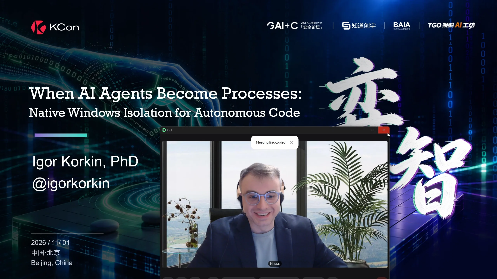
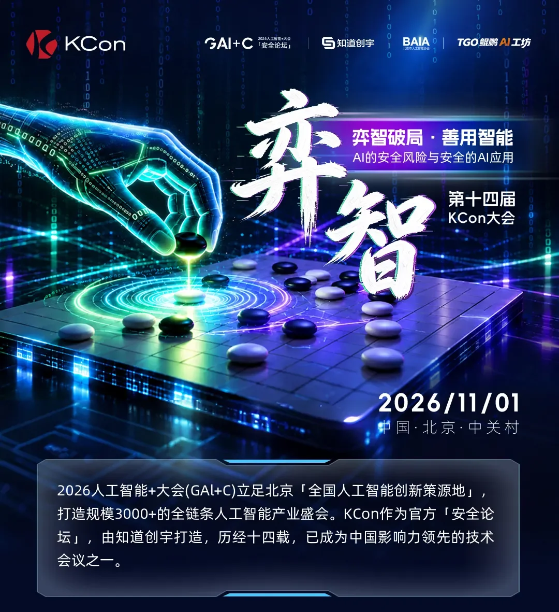
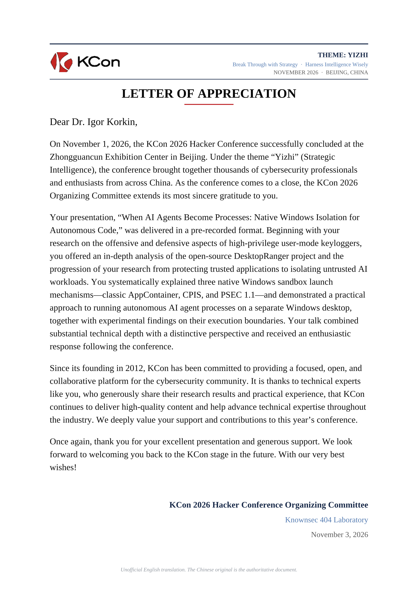
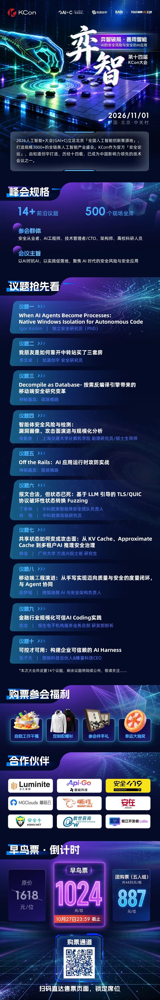

# KCon 2026 | When AI Agents Become Processes: Native Windows Isolation for Autonomous Code

<!-- markdownlint-disable MD033 -->

    
   
  

<!-- markdownlint-enable MD033 -->

## Talk

* **Title:** When AI Agents Become Processes: Native Windows Isolation for Autonomous Code
* **Speaker:** Igor Korkin
* **Event:** 14th KCon Conference 2026 by Knownsec Security
* **Type:** Conference presentation
* **Date:** November 1, 2026
* **Venue:** Zhongguancun National Innovation Demonstration Zone Exhibition Center
* **Location:** Beijing, China
* **Language:** English
* [Watch the recorded talk](https://www.youtube.com/watch?v=BXX7slc5K9g)
* [DesktopRanger on GitHub](https://github.com/IgorKorkin/DesktopRanger)
* Letter-of-Appreciation:
  * [Chinese Original](./KCon-2026-Letter-of-Appreciation-chinese-original.pdf)
  * [English ai-translated](./KCon-2026-Letter-of-Appreciation-english.pdf)
  * [Russian ai-translated](./KCon-2026-Letter-of-Appreciation-russian.pdf)

## Abstract

AI agents are evolving from conversational systems into autonomous applications capable of launching processes, invoking tools, accessing local resources, and interacting with the operating system on behalf of a user.

Once an AI agent becomes executable code, model-level controls are no longer sufficient; the resulting process must also be treated as potentially untrusted at the operating-system level.

This talk presents a practical Windows-native architecture for isolating autonomous AI code. At its core is the Windows Process Security Environment (PSEC). The prototype uses CreateProcessSecurityEnvironment, PROC_THREAD_ATTRIBUTE_SECURITY_ENVIRONMENT, and CreateProcessW to create processes inside a dedicated security environment. PSEC is also compared with the classic AppContainer model based on PROC_THREAD_ATTRIBUTE_SECURITY_CAPABILITIES.

This architecture is being implemented in a new tool, ZIL, which extends DesktopRanger with AppsIsolation—a layer combining three complementary Windows application-isolation techniques to provide both process-level and interactive isolation for autonomous code.

Process isolation is combined with process-tree containment and restricted resource access. The architecture then extends isolation into the Windows interactive subsystem by executing the agent on a dedicated Windows Desktop protected by a hardened security descriptor. This is critical because an autonomous process may attempt to interact with GUI objects, other Desktops, or user input.

Together, these mechanisms combine PSEC-based process isolation with Windows Desktop isolation to provide a broader execution boundary for autonomous and potentially untrusted code.

## Chinese Media Coverage (2026)

The links below document Chinese-language coverage of KCon 2026 and the talk **“When AI Agents Become Processes: Native Windows Isolation for Autonomous Code.”** Verified on November 14, 2026. These are **media mentions**, not peer-reviewed publications. Several outlets reproduce closely related conference reporting; separate URLs should not be interpreted as independent reporting.

### Direct mentions of the speaker and talk

| Outlet | Date | Coverage | Source | PDF snapshot |
| --- | --- | --- | --- | --- |
| Jiemian News (界面新闻) | November 2026 | Names Igor Korkin, gives the full talk title, and describes Windows-native isolation for autonomous AI code. | [Desktop](https://www.jiemian.com/article/15287814.html) · [Mobile](https://m.jiemian.com/article/15287814.html) | Pending |
| Phoenix / Ifeng (凤凰网) | 2026-11-02 | Names Igor Korkin (PhD), cites *When AI Agents Become Processes*, and summarizes the Windows isolation topic. | [Article](https://dongguan.ifeng.com/c/8xj9qbIDBIy) | Pending |
| Sina Technology (新浪科技; attributed to A5创业网) | 2026-11-02 | Names Igor Korkin (PhD) and describes the talk on native Windows isolation. | [Article](https://finance.sina.com.cn/tech/roll/2026-11-02/doc-inixiynw2801148.shtml) | Pending |
| Shishifenxi (时时分析) | November 2026 | Republishes closely related KCon reporting, including the direct Igor Korkin mention. | [Article](https://shishifenxi.com/news?article_id=50ecaa37c508dd607ab1b46b8ab5c08e-0&cat=tech) · [Alternative URL](https://shishifenxi.com/news?cat=tech&article_id=50ecaa37c508dd607ab1b46b8ab5c08e-0&showsum=true) | Pending |

### Official and contextual coverage

* [KCon 2026 official speaker agenda](https://kcon.knownsec.com/index-hacker.html) — lists Igor Korkin and the complete talk title at **09:30–09:55**, November 1, 2026. **PDF:** Pending.
* [ZONE.CI / KCon organizers' post-event recap](https://xyz.zone.ci/secarticles/wx/647326.html) — discusses native endpoint/Agent isolation among the conference topics, without a confirmed direct speaker-name mention in the inspected text.
* [Sohu / 数世咨询 pre-event preview](https://www.sohu.com/a/1092090943_121204941) — October 24 preview mentions agent process isolation as a conference topic; no direct speaker-name mention verified.
* [DWCON pre-event preview](https://www.dwcon.cn/post/5060) — describes the conference and agent isolation theme; no direct speaker-name mention verified.

### Eastday coverage — source supplied by author

* [Eastday (东方网), November 3, 2026](https://qiye.eastday.com/n35/20261103/a3b652d285774cf8a4761d78fed64194.html) — “2026人工智能+大会收官：弈智破局——KCon安全论坛推动AI从‘会用’走向‘可信’”. According to the author-provided excerpt, the report directly names the talk *When AI Agents Become Processes: Native Windows Isolation for Autonomous Code*. The page could not be independently fetched during this update; the direct mention is supported by the author's supplied search excerpt, not independent page inspection. **PDF:** Pending.

### Additional conference schedule and previews

* **Lexotech conference schedule:** the author-supplied search excerpt explicitly shows **Igor Korkin** and the full talk title, and identifies article `did=2c4c861a901d1766b120629f88ec8d03`. This is a **speaker-and-talk schedule mention**, not a post-event news report. The provided URL ends in an ellipsis, so a complete canonical URL and direct page inspection are still outstanding; no guessed URL is published.
* **Lexotech “Top 10 topics” preview:** article `did=a7fee50bb8f3b822cfceb2ee292d9dd6` is identified by the author-supplied excerpt. The talk title is partially visible; a direct speaker-name mention is not confirmed. The full URL is not supplied.
* [KCon WeChat topic preview (1)](https://mp.weixin.qq.com/s/kiF1tEjJ-VxR-XXPNw4hKw) — topic-only reference to Windows GUI isolation for AI agents; a direct speaker-name mention is not confirmed.
* CSDN / Devpress thematic recaps — excluded from the direct-mention list because a simultaneous mention of the speaker name and talk title was not established.

### Additional WeChat link — pending verification

* [WeChat article supplied by the author](https://mp.weixin.qq.com/s/v1HXomGjfNaW6egoDnOfaw) — original URL preserved; publisher, date, article title, and whether Igor Korkin is directly mentioned **not independently verified** (WeChat page could not be opened by the available reader on 2026-11-14). Review the page before classifying it as direct press coverage or archiving a PDF.

### Preservation

PDF links can be added to the **PDF snapshot** column above or after the relevant source as **PDF: [Snapshot](relative/path.pdf)**. Until files are available, **Pending** is plain text (not a broken link).

**First PDF capture priority:** Eastday, Shishifenxi, and the official KCon speaker agenda. Jiemian, Sina and Ifeng have explicit URLs listed above, but their article contents and current accessibility should be rechecked before promising PDF snapshots. Lexotech needs a complete canonical URL before PDF capture. PDF copies are **not yet archived**. For each article, save a browser-generated PDF preserving the Chinese text, images, publisher, publication date and URL. Suggested path: `media-archive/` (create only when snapshots are available). Keep a source-to-PDF manifest with original URL, capture date and SHA-256; do not replace live links. Archive only as permitted by publisher terms and applicable copyright rules.

## Official Posts

* [WeiXin News](https://mp.weixin.qq.com/s/MYJU8bVitjiPVBrL350tkw)
* [Conference web-site](https://kcon.knownsec.com)

## How to Cite

### ГОСТ

<!-- markdownlint-disable MD033 -->
<table>
<tr>
<td>
Коркин И. Ю. When AI Agents Become Processes: Native Windows Isolation for Autonomous Code: доклад на конференции KCon 2026, Пекин, Китай, 1 ноября 2026 г.
</td>
</tr>
</table>
<!-- markdownlint-enable MD033 -->

### APA 7

<!-- markdownlint-disable MD033 -->
<table>
<tr>
<td>
Korkin, I. (2026, November 1). <em>When AI Agents Become Processes: Native Windows Isolation for Autonomous Code</em> [Conference presentation]. KCon 2026, Beijing, China.
</td>
</tr>
</table>
<!-- markdownlint-enable MD033 -->

### Letter of Appreciation

<!-- markdownlint-disable MD033 -->

  

<!-- markdownlint-enable MD033 -->

### Official Announce Poster

<!-- markdownlint-disable MD033 -->

    

<!-- markdownlint-enable MD033 -->